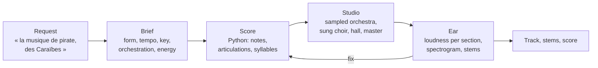

# claude-music-skill

**Your coding agent composes, orchestrates and mixes. A real sampled orchestra and a sung choir play it.**

An [Agent Skill](https://agentskills.io) that turns a one-line request into a finished instrumental track, film and orchestral first. The agent works the way a composer does with a virtual orchestra, and the way an agent drives Blender rather than a model that outputs a picture:

- **It composes like a professional**: a method (brief, reference styles, motif first, harmony, form, orchestration, critique) and ten style sheets, from epic trailer to cinematic pop.
- **It writes the score as code**: every note, articulation, swell, sung syllable and fader move, in a Python file you can read and edit.
- **Real recordings play it**: sampled strings, brass and percussion, and a choir sung by singing-voice models, rendered from the command line, mixed in a hall and mastered to -14 LUFS.
- **An ear checks it**: the agent cannot hear, so the render is measured section by section and drawn as a spectrogram it reads.

No cloud music service, no account needed. Works with any agent that reads `SKILL.md`, runs shell commands and opens an image: Claude Code, Codex, Cursor, Gemini CLI, GitHub Copilot, OpenCode…

## Sound sources

| | Open (default) | BBC Symphony Orchestra Discover (optional) |
|---|---|---|
| What plays | [Sonatina Symphonic Orchestra](https://github.com/peastman/sso) (CC Sampling Plus) and a few [VSCO 2 CE](https://github.com/sgossner/VSCO-2-CE) percussion (CC0), through [sfizz](https://sfz.tools/sfizz/) | [Spitfire Audio's free orchestra](https://www.spitfireaudio.com/products/bbc-symphony-orchestra-discover): real sections recorded together at Maida Vale, one hall |
| Setup | automatic, no account | free with a Spitfire account, then a 2-minute capture |
| Sound | a good mockup | clearly better |

The choir is sung in both, by [DiffSinger](https://github.com/openvpi/DiffSinger) voices through NVIDIA's [BigVGAN](https://github.com/NVIDIA/BigVGAN) vocoder. The same score renders in both modes: the skill picks Discover when it is set up.

## How it works



The design is in [docs/how-it-works.md](docs/how-it-works.md); how the project got there, lead by lead, is in [docs/research-log.md](docs/research-log.md).

## Install

**Any agent.** Copy the skill folder into your agent's skills folder (many read `.agents/skills/` or `~/.agents/skills/`; Claude Code reads `~/.claude/skills/`):

```bash
git clone https://github.com/EtienneLescot/claude-music-skill
cp -r claude-music-skill/skills/music-studio ~/.agents/skills/
```

**Claude Code**, as a plugin:

```
/plugin install music-skill --marketplace EtienneLescot/claude-music-skill
```

The first time you ask for music, the agent runs the setup, asking you first: sfizz, Dragonfly Reverb, the samples, the choir's voices and vocoder, about 2 GB, into `~/.music-studio` (or `STUDIO_HOME`). Nothing is installed system-wide. For Discover, see [docs/install.md](docs/install.md).

## Requirements

| | |
|---|---|
| Agent | reads `SKILL.md`, runs shell commands, opens images |
| Tools | [uv](https://docs.astral.sh/uv/) |
| Disk | about 2 GB, plus PyTorch once in uv's cache to convert the vocoder; 240 MB more for Discover |
| System | Windows tested; the choir runs on the GPU there (DirectML), elsewhere on the CPU, several times slower. macOS and Linux: install `sfizz` from your package manager if setup finds no `sfizz_render` |

## What goes over the network

Nothing you compose leaves your machine. Setup downloads sfizz and Dragonfly Reverb from their GitHub releases, the samples from the Sonatina and VSCO 2 CE GitHub repositories, the choir's two voices from their authors' pages and the BigVGAN vocoder from NVIDIA on Hugging Face. Discover comes from Spitfire, through their app, if you choose it.

## Docs

- [How it works](docs/how-it-works.md): the studio, the orchestra, the choir, the ear
- [Install](docs/install.md): what setup downloads, Discover step by step, platforms
- [Troubleshooting](docs/troubleshooting.md)
- [Research log](docs/research-log.md): every lead tried since the first version, and why the skill looks like this

## Status

Tested on Windows on orchestral and film music. The first version of this skill (Strudel code performed by ACE-Step 1.5) is kept under the tag [v1.1.0](https://github.com/EtienneLescot/claude-music-skill/tree/v1.1.0).

## Licence

MIT, see [LICENSE](LICENSE). The music you make is yours. Sonatina Symphonic Orchestra is CC Sampling Plus, VSCO 2 CE CC0, sfizz BSD-2, Dragonfly Reverb and DawDreamer GPL-3, BigVGAN MIT; the choir's voices allow commercial use (Namine Ritsu by Canon; Hoshino Hanami ~AI❤dol~ by LotteV, with credit). All are downloaded from their sources, not redistributed here. BBC Symphony Orchestra Discover follows Spitfire's terms: music made with it can be released commercially, royalty free; its sounds and patches may not be redistributed or used to train AI, which is why this project ships no Discover data.
