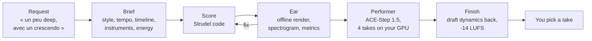

# claude-music-skill

**Your coding agent composes the music. A model on your GPU performs it.**

An [Agent Skill](https://agentskills.io) that turns a one-line request into a finished instrumental track, in any style:

> une musique électro un peu sympa, un peu deep, avec un crescendo

becomes a 1:42 deep house track with a filtered intro, a breakdown and a full groove, delivered as a playable score and four mastered takes.

- **The agent writes the music** as [Strudel](https://strudel.cc) code: form, harmony, arrangement, mix. The score plays as-is on strudel.cc.
- **An offline ear checks it.** The agent cannot hear, so the score is rendered, measured section by section and drawn as a spectrogram the agent reads.
- **ACE-Step 1.5 performs it** on your own GPU, keeping the score's timing and form while giving it a real sound. No cloud music service is involved.

Works with any agent that reads `SKILL.md` and can run shell commands and open an image: Claude Code, Codex, Cursor, Gemini CLI, GitHub Copilot, OpenCode…

## How it works



1. **Brief.** A short request is expanded into style, tempo, key, a timeline in seconds, instruments, energy curve and mix, using genre conventions for whatever you left out.
2. **Score.** One Strudel line per instrument, each gated by a timeline that reads like a DAW arrangement. Drum machines, synths, sample banks and the 128 General MIDI instruments (strings, brass, winds, choir) are available.
3. **Ear.** `ear.py` renders the score in a headless browser, faster than real time, and flags what it finds: clipping, muddy lows, a static arrangement, a silent layer. The agent fixes the score until it is clean.
4. **Performance.** `perform.py` hands the draft to ACE-Step 1.5 in cover mode at strength 0.9: the model re-performs the whole mix in the style of the brief.
5. **Finish.** AI covers flatten dynamics, so each take gets the draft's bar-by-bar levels back, then a true-peak limiter to -14 LUFS. All four takes end at the same loudness, and you choose.

The details, and the listening tests behind every setting, are in [docs/how-it-works.md](docs/how-it-works.md).

## Install

**Any agent.** Copy the skill folder into your agent's skills folder. Many agents read `.agents/skills/` (per project) or `~/.agents/skills/` (per user); Claude Code reads `~/.claude/skills/`. Check your agent's documentation.

```bash
git clone https://github.com/EtienneLescot/claude-music-skill
cp -r claude-music-skill/skills/strudel-composer ~/.agents/skills/
```

**Claude Code**, as a plugin:

```
/plugin install music-skill --marketplace EtienneLescot/claude-music-skill
```

On Claude Code older than 2.1.275, use two steps: `/plugin marketplace add EtienneLescot/claude-music-skill`, then `/plugin install music-skill@claude-music-skill`.

The first time you ask for music, the agent sets up the rest, asking you first: a headless Chromium for the ear, and ACE-Step 1.5 with its models for the performer. See [docs/install.md](docs/install.md) to do it by hand.

## Requirements

| | |
|---|---|
| Agent | reads `SKILL.md`, runs shell commands, opens images |
| Tools | [uv](https://docs.astral.sh/uv/), git |
| GPU | one supported by ACE-Step 1.5: NVIDIA (CUDA), Apple Silicon (MLX), AMD (ROCm), Intel (XPU). Only NVIDIA has been tested so far, on an RTX 4070 Ti |
| Disk | about 10 GB for ACE-Step and its models, plus 200 MB for Chromium |

Without a GPU the skill still composes, checks and hands you the score with its strudel.cc link.

## What goes over the network

Nothing you compose is sent anywhere. The skill only downloads:

- Strudel and its General MIDI soundfont loader, from the jsDelivr and unpkg CDNs, at each render;
- Strudel's sample banks and soundfonts, from raw.githubusercontent.com and felixroos.github.io, at each render;
- Chromium, once, through Playwright;
- ACE-Step 1.5 from GitHub and its models from Hugging Face, once.

The local server in `serve.py` listens on 127.0.0.1 only and only accepts writes of `.wav` files.

## Docs

- [How it works](docs/how-it-works.md): the pipeline, the ear, the listening tests, and six fixes to Strudel's offline rendering
- [Install](docs/install.md): manual setup, per platform
- [Troubleshooting](docs/troubleshooting.md): silent layers, slow takes, timeouts

## Status

Tested end to end on cinematic, lo-fi, techno, ambient, deep house and classical, on Windows with an NVIDIA GPU. Captions for other genres are starting points.

## Licence

MIT, see [LICENSE](LICENSE). Strudel is AGPL-3.0 and is loaded from a CDN, not redistributed. ACE-Step 1.5 code and model weights are MIT ([model card](https://huggingface.co/ACE-Step/Ace-Step1.5)). Strudel's sample banks and the General MIDI soundfonts carry their own licences.
